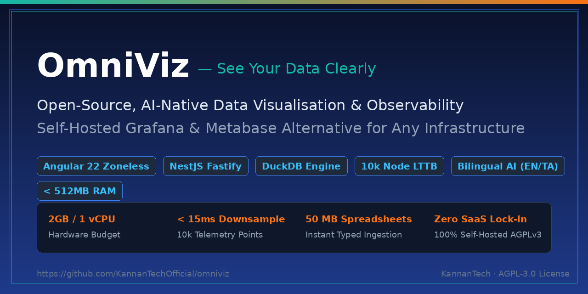
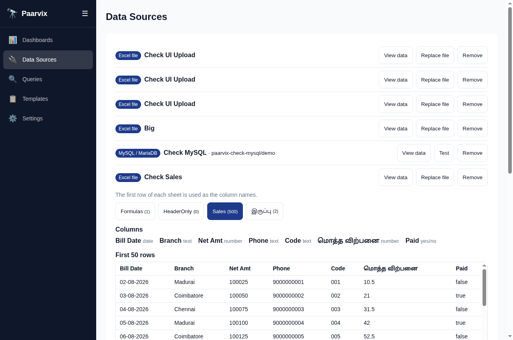

<div align="center">



# OmniViz

### See your data clearly. (Powered by Paarvix Core)

**Open-source, AI-native data visualisation, analytics, and observability platform.**  
Self-hosted Grafana & Metabase alternative. Connect Excel, Google Sheets, MySQL, MariaDB, or PostgreSQL on your own server with zero data team, zero cloud lock-in, and zero per-user fees.

[](LICENSE)
[](docs/roadmap.md)
[](https://angular.dev)
[](https://nestjs.com)
[](https://github.com/KannanTechOfficial/omniviz/discussions)
[](https://github.com/KannanTechOfficial/omniviz/wiki)

[Getting Started](docs/wiki/Getting-Started.md) · [Architecture](docs/wiki/Architecture.md) · [Observability Engine](docs/wiki/Observability-and-Scaling.md) · [Data Sources](docs/wiki/Data-Sources-and-Connectors.md) · [Wiki](https://github.com/KannanTechOfficial/omniviz/wiki) · [Discussions](https://github.com/KannanTechOfficial/omniviz/discussions)



</div>

> **Status: Early Alpha.** Connecting and previewing data, the 10,000-node observability telemetry engine with LTTB downsampling, and the bilingual AI Copilot are available. Dashboard builder is actively evolving.

---

## What is OmniViz?

OmniViz is an open-source, AI-native analytics and observability platform designed to give organisations instant clarity over their operational data and telemetry. Powered by the **Paarvix Core** engine (*Paarvai* / பார்வை, meaning vision in Tamil), OmniViz eliminates expensive BI and monitoring stacks by running fully on your own infrastructure on as little as **2 GB RAM and 1 vCPU**.

It is engineered for both non-technical decision makers (principals, shop owners, hospital admins) and engineers needing real-time cluster telemetry without JVM bloat or SaaS pricing.

---

## Key Features

### 1. Zero-Friction Data Ingestion
- **Excel (.xlsx)**: Drag-and-drop spreadsheets up to 50 MB; every sheet instantly parses into a typed analytical table.
- **Google Sheets**: Connect public or OAuth-authenticated sheets with scheduled sync.
- **Relational Databases**: Direct read-only connectors for MySQL, MariaDB, and PostgreSQL.
- **Indian Locale & Multilingual First**: Built-in parsing for Indian currency (`₹1,25,000`), Indian date formats (`DD-MM-YYYY`), exact preservation of phone numbers/codes (`00123`), and native Tamil interface and schema support.

### 2. High-Scale Observability & Downsampling
- **10,000-Node Cluster Telemetry**: In-memory simulation and streaming metrics across multi-cluster nodes.
- **LTTB Downsampling Engine**: Largest-Triangle-Three-Buckets algorithm compresses 10,000 raw time-series points to 500 visual points in `< 15ms`, preserving visual peaks and dips without browser lag.
- **Apache ECharts Acceleration**: Interactive zoom, pan, and real-time refreshes.

### 3. Bilingual AI Copilot
- **Natural Language to Query**: Ask operational questions in English or Tamil (*"Show top 5 departments by attendance"* or *"கடைசி மாத விற்பனை எவ்வளவு?"*).
- **Provider-Agnostic**: Compatible with OpenAI, Ollama (local private AI), Google Gemini, and Anthropic.
- **Read-Only Guardrails**: AI never executes write commands and respects Row-Level Security.

### 4. Enterprise Security on Your Own Terms
- **Read-Only Sandbox**: All queries execute within read-only transactions with a 30-second hard timeout and 10,000-row cap.
- **AES-256 Envelope Encryption**: Data source credentials encrypted at rest.
- **Zero Telemetry**: No phone-home scripts, tracking pixels, or data collection. Your data never leaves your hardware.

---

## OmniViz vs Other Platforms

| Feature | OmniViz | Grafana | Metabase | Apache Superset |
|:---|:---:|:---:|:---:|:---:|
| **Server Footprint** | **< 512 MB RAM** | Moderate | Heavy (JVM 2GB+) | Heavy (Python 2GB+) |
| **Setup Time** | **< 2 minutes** | 30+ minutes | 15 minutes | 45+ minutes |
| **Excel / Sheets Ingestion** | **Native Drag-and-Drop** | Plugin / Complex | Limited | Complex |
| **Time-Series Observability** | **LTTB Downsampled** | Native TSDB | Basic | Basic |
| **Bilingual AI Copilot** | **Built-in (EN / TA)** | Add-on / Cloud | Cloud / Paid | Experimental |
| **Indian Locale & Formats** | **Native Lakh/Crore** | Manual Formatting | Limited | Limited |
| **Telemetry / Tracking** | **100% Zero Telemetry** | Opt-out / Cloud | Opt-out | Self-hosted |
| **License** | **AGPLv3 (Free forever)** | AGPLv3 | AGPLv3 | Apache 2.0 |

---

## Quick Start (Docker)

Run OmniViz locally or on any cloud server:

```bash
git clone https://github.com/KannanTechOfficial/omniviz.git
cd omniviz
./install.sh
```

The installer configures environment secrets, starts the Docker stack, and outputs your login URL. Open the browser, register your admin account, and visit **Data Sources** or **Observability**.

Manage lifecycle:
```bash
./run.sh status   # Check container health and ports
./run.sh logs     # View live logs
./run.sh stop     # Gracefully stop containers
```

---

## Development Setup

```bash
# Clone the repository
git clone https://github.com/KannanTechOfficial/omniviz.git
cd omniviz

# Install dependencies
npm install

# Configure environment
cp .env.example .env

# Run API and Web in development mode
npm run dev:api
npm run dev:web
```

- **Frontend**: [http://localhost:4200](http://localhost:4200) (Angular 22 Zoneless Signals)
- **Backend API**: [http://localhost:3000](http://localhost:3000) (NestJS + Fastify)

---

## Documentation & Wiki

Comprehensive technical guides are available in the [OmniViz Wiki](https://github.com/KannanTechOfficial/omniviz/wiki) and repository:
- [Architecture & Columnar DataFrames](docs/wiki/Architecture.md)
- [Data Sources & Security Sandboxing](docs/wiki/Data-Sources-and-Connectors.md)
- [10,000-Node Observability & Downsampling](docs/wiki/Observability-and-Scaling.md)
- [Security & Envelope Encryption](docs/wiki/Security-and-Permissions.md)
- [Full Roadmap & Phases](docs/roadmap.md)

---

## Community & Contributing

- Join discussions and feature ideas on [GitHub Discussions](https://github.com/KannanTechOfficial/omniviz/discussions).
- Report bugs and security considerations via [Issues](https://github.com/KannanTechOfficial/omniviz/issues) and [SECURITY.md](SECURITY.md).
- Read [CONTRIBUTING.md](CONTRIBUTING.md) and [CODE_OF_CONDUCT.md](CODE_OF_CONDUCT.md) before submitting Pull Requests.

---

## License

OmniViz is licensed under the [GNU Affero General Public License v3.0 (AGPLv3)](LICENSE).  
Copyright (C) 2026 Kannan / KannanTech (https://kannantech.com).  
Commercial licensing and enterprise support: [paarvix@kannantech.com](mailto:paarvix@kannantech.com).
